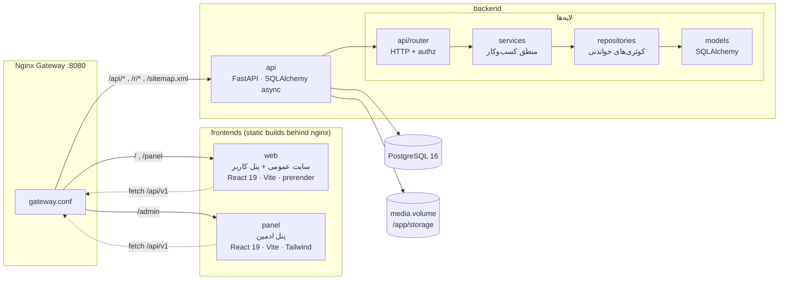

# معماری

مونوریپوی سه‌سرویسی + دیتابیس + gateway. سایت عمومی، پنل کاربر و پنل ادمین
سه تجربه‌ی مجزا هستند که روی یک API واحد و یک مکانیزم احراز هویت واحد سوارند.

## تصمیم‌های معماری کلیدی

- **یک فرم لاگین برای همه:** ادمین، کارمند، مشتری و بازاریاب از یک فلوی
  ثبت‌نام/ورود عبور می‌کنند؛ نقش‌ها مسیر پنل را تعیین می‌کنند (`/admin` در
  برابر `/panel`). نشست با کوکی HttpOnly امضاشده — فقط هش توکن در DB است.
- **سایت عمومی offline-first:** محتوای صفحات از CMS می‌آید ولی همه‌ی خروجی‌ها
  fallback استاتیک دارند (`src/content/lawyers.fa.js`) — با قطع API سایت
  کامل بالا می‌آید و pre-render شده است.
- **سرور مرجع همه‌ی چیزهای حساس:** attribution ارجاع، محاسبه‌ی کمیسیون،
  واجدشرط‌بودن تسویه، دسترسی‌ها و audit فقط سمت سرور تصمیم گرفته می‌شوند.
- **رسانه‌ی خصوصی:** فایل‌های `purpose=receipt` هرگز از مسیر عمومی سرو
  نمی‌شوند — فقط با نشست ادمین.
- **دستیار AI اختیاری:** بدون `AI_API_KEY` سیستم در حالت retrieval-only
  کار می‌کند و پاسخ خودکار «پاسخ خودکار سیستم» برچسب می‌خورد و idempotent است.

## ساختار بک‌اند (`backend/main/`)

| لایه | مسیر | مسئولیت |
|---|---|---|
| router | `api/router/` (+`admin/`) | HTTP، validation، authz dependency |
| services | `services/` | کمیسیون، ارجاع، پرداخت، مدیا، thread، inbox |
| repositories | `repositories/` | کوئری‌های خواندنی چند‌مدلی (لیست‌های ادمین) |
| models | `models/` | declarative ORM + constraintها |
| schemas | `schemas/` | Pydantic ورودی/خروجی |
| security | `security/` | Argon2id، session، vault (AES-256-GCM بانک) |
| core | `core/` | config (pydantic-settings)، rate-limit، logging |
| ai | `ai/` | provider، knowledge، render، retrieval |
| tasks | — | (حذف شد — بدون worker جدا) |

قانون: منطق کسب‌وکار در route نمی‌ماند؛ route فقط اعتبارسنجی + dependency +
صدا زدن service است.

## ساختار فرانت‌ها

- `frontend/` — سایت عمومی + پنل کاربر در `/panel`: `pages/` (صفحات)،
  `pages/account/` (پنل کاربر)، `components/`، `sections/`، `content/` (کپی
  + overlay ریموت)، `services/` (api, auth, referral)، design tokens در
  `styles/tokens.css`.
- `panel/` — ادمین: `pages/` (به‌تفکیک دامنه: requests، marketing، content)،
  `components/` (RichEditor، ui)، `layouts/AppLayout`، `types/api.ts`.

## مستندات مرتبط

- `docs/database.md` — ERD و کاتالوگ جدول‌ها
- `docs/referral-and-commission.md` — منطق ارجاع/کمیسیون/تسویه
- `docs/deployment.md` — استقرار production
- `docs/api.md` — نمای API
