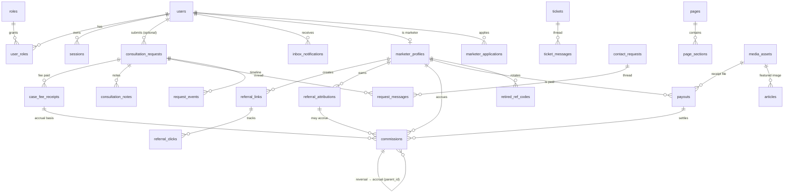

# دیتابیس

PostgreSQL 16 درست با Alembic مهاجرت می‌شود؛ توسعه‌ی محلی و تست‌ها روی SQLite
(از طریق `aiosqlite`) اجرا می‌شوند. زنجیره‌ی مهاجرت از صفر تا head بدون خطا
اجرا می‌شود و همه‌ی مهاجرت‌ها idempotent هستند (نصب تازه، schema نهایی را
مستقیم از metadata می‌سازد).

## واحد پول

همه‌ی مبالغ `BIGINT` و به **تومان** هستند (مهاجرت 0011 مقادیر قبلی ریال را ÷۱۰
کرده). هیچ ستون پولی float نیست. در UI همیشه برچسب «تومان» چاپ شود.

## ERD (نمای کلیدی)



## کاتالوگ جدول‌ها

| جدول | نقش |
|---|---|
| `users` | کاربران (ادمین/کارمند/مشتری/بازاریاب) — username یکتا، phone یکتا برای غیرخالی |
| `roles` / `user_roles` | RBAC — super_admin, admin, editor, support, user, marketer |
| `sessions` | نشست‌ها — فقط هش SHA-256 توکن ذخیره می‌شود، کوکی opaque |
| `password_reset_tokens` / `otp_tokens` | بازیابی رمز / ورود با OTP — هش‌شده |
| `consultation_requests` | درخواست‌های مشاوره — tracking_code یکتا، access_code هش‌شده، fee_amount (تومان ≥0) |
| `consultation_notes` | یادداشت داخلی کارمندان روی پرونده (CASCADE با درخواست) |
| `tickets` / `ticket_messages` | تیکت‌های تماس عمومی + رشته‌ی پیام |
| `contact_requests` | درخواست‌های تماس — مدیریت یکپارچه با consultations در admin |
| `request_messages` / `request_events` | رشته‌ی پیام و تایم‌لاین رویداد برای همه‌ی انواع درخواست |
| `request_labels` / `labels` | برچسب‌گذاری درخواست‌ها در ادمین |
| `case_fee_receipts` | فیش‌های حق‌الوکاله دریافتی از موکل (تومان، ≥0) — مبنای کمیسیون |
| `marketer_applications` | درخواست عضویت بازاریاب + نسخه‌ی قوانین پذیرفته‌شده |
| `marketer_profiles` | بازاریاب تأییدشده — ref_code یکتا، بانک رمزنگاری‌شده، custom_rate 0..100 |
| `marketing_terms` | متن قوانین بازاریابی — نسخه‌بندی append-only |
| `referral_links` | لینک‌های کانالی بازاریاب (instagram/telegram/…) — یکتا per (marketer,label) |
| `referral_clicks` | کلیک روی لینک — ip/user_agent هش‌شده، پرچم suspicious |
| `referral_attributions` | تخصیص ارجاع به بازاریاب — consent_at گیت نام/کمیسیون، channel |
| `retired_ref_codes` | کدهای قدیمی بازاریاب — لینک‌های قدیمی همچنان resolve می‌شوند |
| `commissions` | دفتر کمیسیون **append-only**: accrual/reversal، مبالغ تومان، rate_bp 0..10000 |
| `payouts` | دسته‌ی تسویه — مبلغ >0، فیش بانکی (MediaAsset purpose=receipt) |
| `payout_requests` | درخواست برداشت بازاریاب (legacy، در UI فعلی استفاده نمی‌شود) |
| `wallet_ledger` | دفتر کیف پول (legacy — تسویه فعلی از طریق payouts است) |
| `inbox_notifications` | اعلان درون‌برنامه‌ای کاربر |
| `articles` | مقالات — slug یکتا، status (draft/scheduled/published/archived)، SEO |
| `content_revisions` | اسنپ‌شات نسخه‌ها برای صفحات/تنظیمات/مقالات |
| `pages` / `page_sections` | CMS صفحات سایت + سکشن‌های ترتیب‌دار |
| `site_settings` | تنظیمات key-value (brand, contact, seo, socials, footer, ai, commission) |
| `lawyers` | وکلا — slug یکتا، resume JSON |
| `media_assets` | فایل‌های آپلودی — purpose=public/receipt (receipt عمومی سرو نمی‌شود) |
| `ai_conversations` / `ai_messages` / `ai_knowledge_sources` | دستیار هوش مصنوعی — گفتگو + دانش |
| `audit_logs` | لاگ حسابرسی اقدامات حساس (login, bank change, payout, …) |
| `outbound_deliveries` | صف اعلان‌های خروجی (mock/smtp/sms) |
| `tracking_counters` | شمارنده‌ی سالانه برای کدهای DN-YYYY-NNNN |

## قواعد یکپارچگی

- **Unique:** `users.username`، `users.phone` (فقط غیرخالی)، `marketer_profiles.ref_code`،
  `referral_links (marketer_id,label)`، `referral_attributions (request_type,request_id)`،
  `commissions.receipt_id`، `articles.slug`، `consultation_requests.tracking_code`،
  `tickets.ticket_number`، `marketing_terms.version`.
- **CHECK (0012):** `custom_rate` 0..100، `rate_bp` 0..10000، `basis_amount`≥0،
  `case_fee_receipts.amount`≥0، `payouts.amount`>0، `fee_amount`≥0.
- **FK با رفتار مشخص:** CASCADE برای داده‌های فرزند (پیام‌ها، رویدادها، فیش‌ها،
  ارجاع‌ها، کمیسیون‌ها نسبت به والد)، SET NULL برای نویسنده/فایل ضمیمه.
- **Append-only:** کمیسیون‌ها هرگز update مالی نمی‌شوند — برگشت = ردیف reversal
  با `parent_id` به accrual. marketing_terms نسخه‌ای است.

## ایندکس‌های اصلی

| مسیر پرتکرار | ایندکس |
|---|---|
| ارجاع‌های بازاریاب + تاریخ | `ix_referral_attributions_marketer_created` |
| rollup کلیک (کد + تمیز) | `ix_referral_clicks_code_clean` |
| کمیسیون (بازاریاب، وضعیت، تاریخ) | `ix_commissions_marketer_status_created` |
| درخواست (کاربر، وضعیت، تاریخ) | `ix_consultation_requests_user_status` |
| lookup تلفن درخواست | `ix_consultation_requests_phone` |
| اعلان خوانده‌نشده | `ix_inbox_notifications_user_read` |
| تک‌accrual بدون فیش | `uq_commission_nullreceipt` (partial unique) |

نتایج `EXPLAIN ANALYZE` روی دیتاست ۱۰k ارجاع / ۱۰۰k کلیک / ۵۰k کمیسیون: همه‌ی
پرس‌وجوهای داغ index-driven و زیر ۱۰ms.

## Seed

| دستور | محتوا | محیط |
|---|---|---|
| `python -m main.cli roles` | فقط نقش‌های RBAC | ضروری — همیشه امن و idempotent |
| `python -m main.cli seed` | تنظیمات، صفحات، وکلا، قوانین پیش‌فرض (محتوای واقعی سایت) | dev / اولین deploy — با `SEED_ON_BOOT` |
| `python -m main.cli seed-dev` | داده‌ی دموی ساختگی (کاربر/بازاریاب/مشاوره/مقاله) | **فقط توسعه** — در production رد می‌شود |
| `python -m main.cli bootstrap-admin` | ساخت super_admin اولیه با رمز صریح | دستی — هیچ رمز پیش‌فرضی در کد نیست |

## Backup / Restore

```bash
./scripts/backup.sh            # → ./backups/dadnovin-<ts>.sql.gz
./scripts/restore.sh <file>    # تایید تعاملی + migrate به head بعد از restore
```
